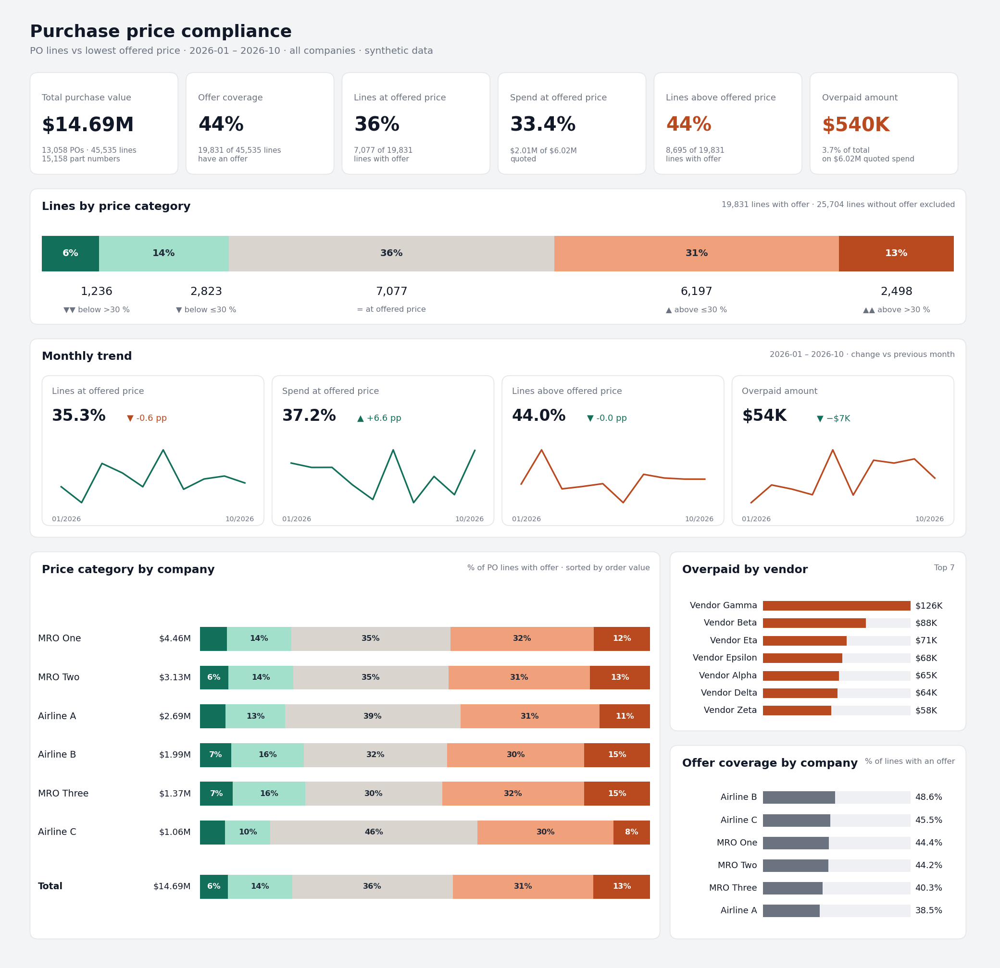
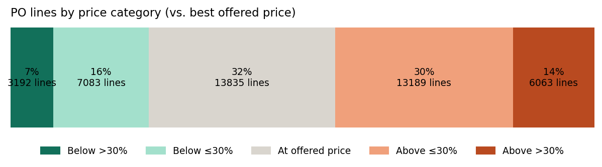
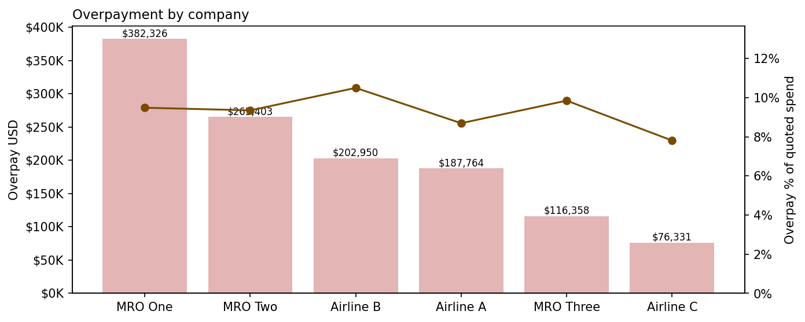
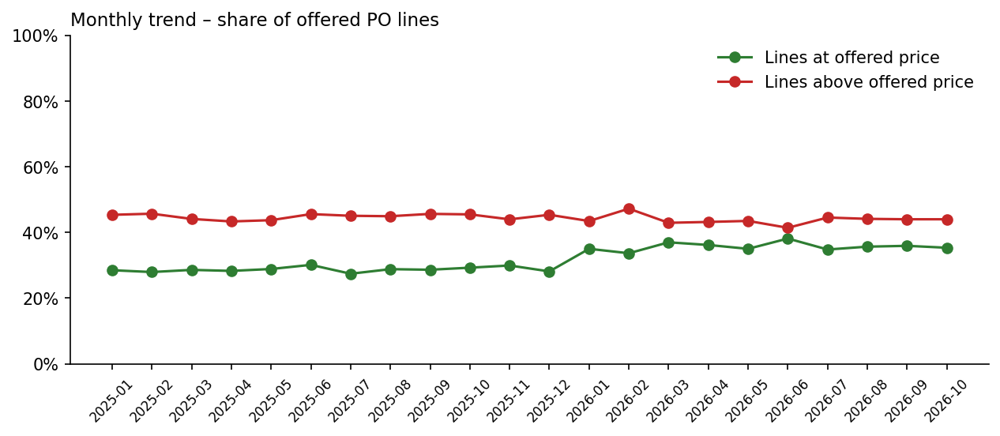
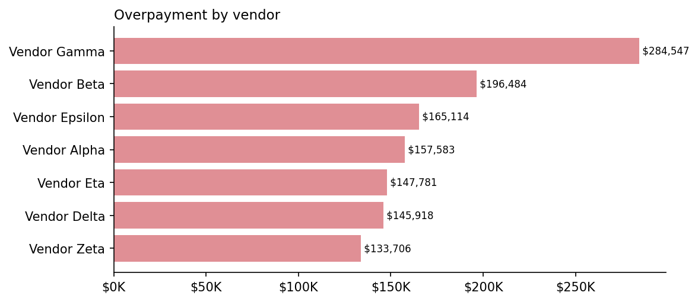
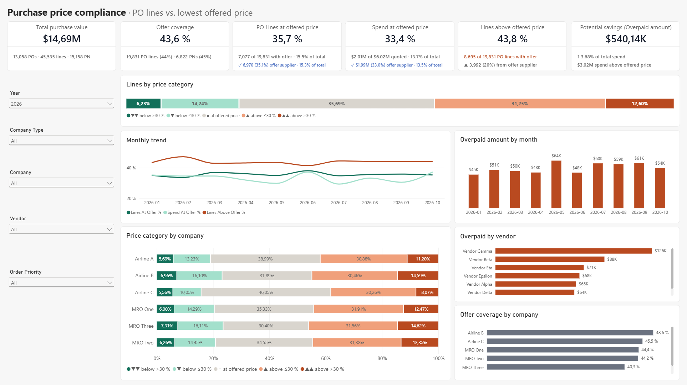

# Supplier Price Comparison & Price Compliance – Python

A Python project that turns messy supplier offer files and 100,000 purchase
order lines into answers buyers and managers need:

1. **Who offers the best price** for each part – even when every supplier sends
   a differently structured Excel file.
2. **Are we actually buying at that price** – and where, with whom and how much
   do we overpay?

> All data in this repository is **synthetic**. Part numbers, companies,
> suppliers, prices and quantities are randomly generated by
> `generate_sample_data.py`.



## Data (synthetic)

| File | Content | Size |
|---|---|---|
| `base_purchases.xlsx` | parts we buy, ordered quantity, price paid today | 20,000 part numbers |
| `offers/offer_vendor_*.xlsx` | five supplier offers, each in its own layout | 2,000–3,000 unique part numbers per supplier (13,461 offer lines) |
| `purchase_order_lines.xlsx` | PO lines 2025-01 – 2026-10, six companies (airlines and MROs), seven vendors | 100,000 lines · ~18,000 part numbers |

## Part 1 – Supplier price comparison (`compare_prices.py`)

### The problem

Every supplier file looks different:

| Supplier | Part number column | Price column | Format quirks |
|---|---|---|---|
| Vendor Alpha | `Requested Part Number` | `Price USD` | offers alternative part numbers |
| Vendor Beta | `PartNumber` | `Sales Price` | European numbers as text (`1 234,56`), lower-case and padded part numbers |
| Vendor Gamma | `PNR` | `UNP` | quantity price breaks, some breaks incomplete |
| Vendor Delta | `P/N` | `Price USD` | US thousands separators as text (`1,234.56`), EUR column |
| Vendor Epsilon | `Cust Req'd Part` | `Price (USD)` | several offers per part, parts never bought before |

### What the script does

1. **Maps each supplier's columns** to standard names via `config.py` – a new
   supplier is one new block, no code changes.
2. **Cleans part numbers** (spaces, non-breaking spaces, case) and **parses
   European and US number formats**.
3. **Keeps the cheapest valid offer** when a supplier quotes a part several times.
4. **Applies quantity breaks** – the price of the largest break the ordered
   quantity reaches; incomplete breaks never win.
5. **Ranks suppliers** per part – best, second, third – with vectorised NumPy.
6. **Separates original and alternative part numbers**, with a best price for
   the exact requested part as well.
7. **Estimates savings** against the price paid today.

Quantity breaks in action (Vendor Gamma):

| Part | Ordered qty | 1+ | 50+ | 200+ | Price used |
|---|---|---|---|---|---|
| FK-10060 | 387 | 15.14 | 13.93 | 12.87 | **12.87** |
| FK-10025 | 2 | 21.03 | 19.35 | – | **21.03** |
| FK-10000 | 273 | 5.39 | 4.96 | *price missing* | **4.96** |

Result: 9,627 of 20,000 parts have at least one offer; 5,148 have a cheaper
original offer than the price paid today.

## Part 2 – Price compliance (`price_compliance.py`)

Every PO line is compared with the best offered price for the same original
part number and placed in one of five categories: **▼▼ below >30 %,
▼ below ≤30 %, = at offered price, ▲ above ≤30 %, ▲▲ above >30 %.**



**Company summary (2025–2026)** – by company type, with subtotals:

| Type | Company | Spend | Spend with offer | Bought at offered price* | Overpay | Overpay % of quoted spend |
|---|---|---|---|---|---|---|
| Airlines | Airline A | $5.88M | 37 % | 33 % | $188K | 8.7 % |
| Airlines | Airline B | $4.49M | 43 % | 28 % | $203K | 10.5 % |
| Airlines | Airline C | $2.39M | 41 % | 40 % | $76K | 7.8 % |
| MRO | MRO One | $9.62M | 42 % | 33 % | $382K | 9.5 % |
| MRO | MRO Two | $6.56M | 43 % | 30 % | $265K | 9.4 % |
| MRO | MRO Three | $3.03M | 39 % | 28 % | $116K | 9.8 % |
| **All** | | **$31.96M** | **41 %** | **31 %** | **$1.23M** | **9.4 %** |

\* share of quoted spend

The share of offered lines bought at the offered price rose from **29 % in 2025
to 36 % in 2026**.





`price_compliance.xlsx` contains the KPIs, company summary, category split by
company, monthly KPIs and a vendor view. `dashboard.py` draws the one-page overview at
the top of this page for the latest year.

## Part 3 – Power BI report

`export_powerbi.py` writes star-schema CSV tables (`fact_po_lines`, `dim_part`,
`dim_company`, `dim_vendor`, `dim_category`) that feed an interactive Power BI
report. `run_all.py` runs the whole pipeline and opens the report, which
reloads the fresh data – one command from raw offer files to an updated
dashboard. Figures in the report match the Python results exactly.

Slicers: year, company type, company, vendor, order priority. KPI cards show
the main figure plus context, e.g. how much of the spend at the offered price
was bought from the supplier that made the offer.



*The Power BI file itself is not included in this repository.*

## How to run

```bash
pip install -r requirements.txt
python generate_sample_data.py   # synthetic input data (optional – already included)
python compare_prices.py         # -> data/output/price_comparison.xlsx
python price_compliance.py       # -> data/output/price_compliance.xlsx + charts + Power BI tables
```

Or everything in one go (and open the Power BI report):

```bash
python run_all.py
```

## Project structure

```
├── config.py                 file paths, supplier column mappings, thresholds
├── compare_prices.py         part 1: supplier offer comparison
├── price_compliance.py       part 2: PO lines vs. offers, summaries, charts
├── dashboard.py              one-page overview (Matplotlib)
├── export_powerbi.py         star-schema CSV tables for Power BI
├── run_all.py                runs the pipeline and opens the Power BI report
├── generate_sample_data.py   synthetic input data
├── requirements.txt
└── data/
    ├── input/                base purchases, PO lines, supplier offers
    └── output/               Excel reports and charts/
```

## Tools

Python · pandas · NumPy · Matplotlib · openpyxl · Power BI · DAX · Excel

## Note

Portfolio version of a tool built in a professional context. It contains no
company data, company names or supplier names.
